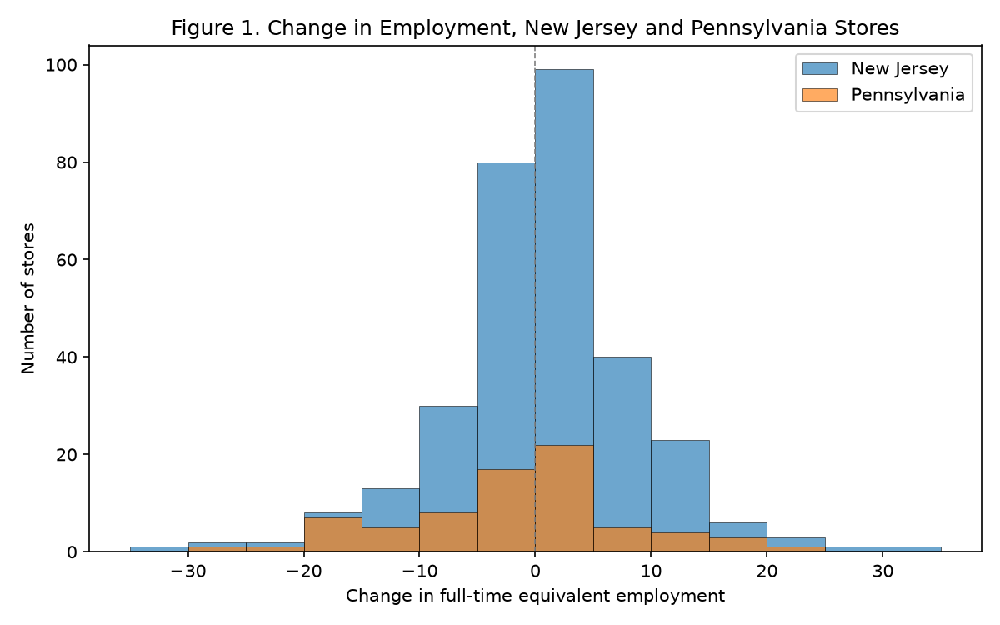

# Card & Krueger (1994) — Reproduction (Tables 2, 3, 4, Figure 1)

Data: `data/public.csv` (410 fast-food stores).  FTE = full-time + managers + 0.5 × part-time.

## Table 3 — Average employment per store before and after the NJ minimum-wage rise

|  | PA | NJ | Diff NJ-PA | NJ wage=$4.25 | NJ wage $4.26-$4.99 | NJ wage >=$5.00 | Low-high | Mid-high |
|---|---|---|---|---|---|---|---|---|
| 1. FTE employment before | 23.33 (1.35) | 20.44 (0.51) | -2.89 (1.44) | 19.56 (0.77) | 20.08 (0.84) | 22.25 (1.14) | -2.69 (1.37) | -2.17 (1.41) |
| 2. FTE employment after | 21.17 (0.94) | 21.03 (0.52) | -0.14 (1.08) | 20.88 (1.01) | 20.96 (0.76) | 20.21 (1.03) | 0.66 (1.44) | 0.74 (1.27) |
| 3. Change in mean FTE | -2.17 (1.22) | 0.59 (0.47) | 2.75 (1.31) | 1.32 (0.81) | 0.87 (0.67) | -2.04 (0.98) | 3.36 (1.27) | 2.91 (1.19) |
| 4. Change, balanced sample | -2.28 (1.25) | 0.47 (0.48) | 2.75 (1.34) | 1.20 (0.82) | 0.71 (0.69) | -2.16 (1.01) | 3.36 (1.30) | 2.87 (1.22) |
| 5. Change, temp. closed set to 0 | -2.28 (1.25) | 0.23 (0.49) | 2.51 (1.35) | 0.90 (0.87) | 0.49 (0.69) | -2.39 (1.02) | 3.29 (1.34) | 2.88 (1.23) |

Wage-group sizes (NJ, wave-1 starting wage): $4.25 N=101, $4.26-$4.99 N=140, ≥$5.00 N=73.

## Table 2 — Means of key variables (NJ vs PA)

| Variable | NJ | PA | t |
|---|---|---|---|
| Burger King (%) | 41.09 | 44.30 | -0.5 |
| KFC (%) | 20.54 | 15.19 | 1.2 |
| Roy Rogers (%) | 24.77 | 21.52 | 0.6 |
| Wendy's (%) | 13.60 | 18.99 | -1.1 |
| Company-owned (%) | 34.14 | 35.44 | -0.2 |
| FTE employment, before | 20.44 | 23.33 | -2.0 |
| % full-time employees | 24.92 | 26.56 | -0.6 |
| Starting wage, before | 4.61 | 4.63 | -0.4 |
| Wage = $4.25 (%) | 30.51 | 32.91 | -0.4 |
| Price of full meal | 3.35 | 3.04 | 4.0 |
| Hours open, weekday | 14.42 | 14.53 | -0.3 |
| Recruiting bonus (%) | 23.56 | 29.11 | -1.0 |
| FTE employment, after | 21.03 | 21.17 | -0.1 |
| Starting wage, after | 5.08 | 4.62 | 10.8 |
| Price of full meal, after | 3.41 | 3.03 | 5.1 |
| Hours open, weekday, after | 14.42 | 14.65 | -0.6 |

## Table 4 — Reduced-form models for the change in FTE employment

Sample: 365 stores; mean ΔFTE = -0.252, SD = 8.749.

| Model | NJ dummy | wage gap | controls | SER |
|---|---|---|---|---|
| (i) | +2.36 (1.15) | — | — | 8.71 |
| (ii) | +2.33 (1.15) | — | CO_OWNED, chain_2, chain_3, chain_4 | 8.70 |
| (iii) | — | +15.89 (5.95) | — | 8.68 |
| (iv) | — | +15.19 (6.08) | CO_OWNED, chain_2, chain_3, chain_4 | 8.67 |
| (v) | — | +12.03 (7.32) | CO_OWNED, chain_2, chain_3, chain_4, CENTRALJ, NORTHJ, PA1, PA2 | 8.67 |

## Within-NJ treatment-intensity DiD (extension)

Sample restricted to New Jersey (all PA dropped); no 0/1 control group — treatment intensity is the continuous `GAP = max(0, (5.05 - WAGE_ST)/WAGE_ST)`, so stores already paying ≥ $5.05 have GAP = 0 and act as the within-state reference.

Regression sample: N = 293 NJ stores; mean ΔFTE = +0.213.

| Specification | GAP coefficient | s.e. | t | p |
|---|---|---|---|---|
| GAP only | +13.08 | 6.60 | 1.98 | 0.048 |
| + chain & ownership | +12.27 | 6.82 | 1.80 | 0.073 |
| + region | +12.14 | 6.87 | 1.77 | 0.078 |

Discrete Low−High contrast (wage = $4.25 vs ≥ $5.00): **+3.36 FTE** (s.e. 1.28, p = 0.009); Mid−High = +2.87 (s.e. 1.20, p = 0.017). Both versions indicate no negative employment effect.

## Notes

- **FTE** = full-time employees + managers + 0.5 × part-time employees. Permanently-closed stores (STATUS2 = 3, six stores) are assigned zero wave-2 employment; temporarily-closed stores (STATUS2 ∈ {2,4,5}, four stores) are treated as missing, except in row 5 of Table 3 where they are set to zero.
- **Table 3, row 3** is the unbalanced *after − before* difference; its standard error uses the formula for the difference of two partially-overlapping sample means. Rows 4–5 use the store-level change over the balanced panel.
- **The public-use `cardkrueger` file differs slightly from the paper's wave-1 staffing mix.** Wave-1 *FTE* and all wave-2 figures reproduce the published values exactly, but the file records fewer full-time and more part-time employees in wave 1, so the computed “% full-time employees” row (≈25% vs the paper's 32.8%) and the row-3 standard errors (a touch smaller) differ. The DiD point estimate and its conclusion are unaffected.
- **Table 4** uses `NJ`-dummy specifications (i)–(ii) and a wage-gap (=(5.05 − starting wage)/starting wage for NJ, 0 for PA) specification (iii)–(v). The regression sample here has 365 stores vs. 357 in the paper.

*Figure 1 saved to /Users/cihaoling/Desktop/ECON6067/大作业/01_DID/output/figure1_change_in_employment.png*  (NJ change: n=309, mean=0.47; PA change: n=75, mean=-2.28).